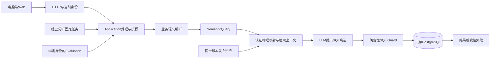
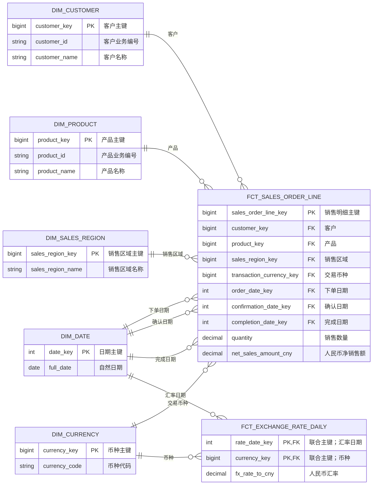

# ChatBI架构

本文说明当前整体结构、模块职责、依赖与数据归属。能力边界见 [产品范围](product-scope.md)，具体行为见 [Spec](specs)，代码导航见 [README](../README.md)。

## 定位与依赖

ChatBI是Domain AI Engine，采用Modular Monolith。依赖方向为 `Interfaces → Application → Domain`；Application依赖Port / Contract，Infrastructure提供Adapter。这里描述职责，不要求每个模块建设同样的目录或抽象层。

业务事实由Domain和权威数据定义；模型输出是未受信任候选。Provider、Database和Platform SDK留在边界，替换技术不能反向修改业务口径。

## 当前模块职责

| 模块 / 能力 | 职责 |
| --- | --- |
| Web / Query API | HTTP、Cookie / Bearer身份、输入输出、执行受理与观察；不复制查询或分析逻辑。 |
| Account / Authorization | 账号、Session、固定RBAC、归属与审计；每轮使用当前身份和策略。 |
| Online Query / Retrieval | 业务语义解析、当前认证物理上下文、模型SQL候选、Guard和只读执行；不拥有用户会话。 |
| Multi-Turn / History / Execution | Application拥有短期状态、持久快照、完整续聊条件、执行生命周期和取消；成功才提交受控状态。 |
| Business Analysis | 两期目标校验、固定任务、当前授权查询、确定性归因与受校验总结；不继承问数状态。 |
| Result Export | 从有权访问的成功快照生成文件，隔离renderer并回收资源；不再执行业务查询。 |
| Semantic / Structure | 指标与业务绑定、结构事实及认证映射；展示格式不定义业务口径。 |
| RAG Offline | 验证离线事实、生成三类文档 / 向量与关系图、完整版本发布；不参与在线请求或修改业务库。 |
| Bootstrap / Operations | 初始化、资源装配、失败清理、就绪与本机备份恢复；业务模块不依赖bootstrap。 |
| Observability / Evaluation | 安全旁路诊断；同一正式链路的离线案例验证。诊断不决定业务终态。 |

## 核心查询链路

自然语言不能直接映射到数据库列。语义、认证物理映射与SQL安全都由程序核验；API、多轮、历史、分析和评测复用同一条查询链。

## 数据与状态归属

| 来源 / 对象 | 权威身份与用途 |
| --- | --- |
| PostgreSQL Sales Mart catalog | 当前物理结构；Structure generated是它的投影。 |
| Semantic metrics / query_bindings | 指标定义、固定口径和规范业务身份绑定。 |
| result_display | 单位 / 格式等展示属性；不能覆盖指标或业务映射。 |
| RAG manifest / current指针 | 完整发布版本、结构 / 指标 / Embedding来源指纹。 |
| chatbi_control | 账号、Session、RBAC、审计、私人历史 / 成果、execution与checkpoint；与只读业务连接分离。 |
| 短期会话 | Application进程内状态；长期历史独立持久化，不能靠延长TTL代替。 |
| Query / Analysis成功快照 | 保存当时公开结果与完整业务条件；重开只读，续聊重新认证当前定义。 |

## 数据模型

这里的 Entity（实体）是数据库中需要保存的业务数据对象，不是代码里的 Class（类）。下图只保留理解业务关系所需的核心字段：

- `PK` = Primary Key（主键），唯一标识一条记录。
- `FK` = Foreign Key（外键），指向另一张表的主键。
- `dim_` = Dimension（维度），描述日期、客户、产品等业务对象。
- `fct_` = Fact（事实），记录销售明细、汇率等业务事实。

## 离线检索资产

RAG Offline Build 的当前职责：

- `scripts/metadata/export_schema.py` 仍只是结构导出辅助脚本，不等同于离线构建。
- `src/structure/generated/` 是从实际 PostgreSQL catalog 导出的结构投影；`src/semantic/metrics.json` 是指标定义与口径事实源。
- `src/rag_offline/` 负责校验事实、生成文档、向量化、写入 Qdrant、构建关系图和发布完整资产。
- `data/rag/current.json` 是当前发布指针，版本目录保存 manifest 和关系图。Manifest 记录结构 Metadata、Metrics 和 Embedding 配置来源指纹。
- production 服务进入 Ready 前比较 PostgreSQL catalog、Structure Metadata 和当前 manifest；旧 manifest、输入变更或无法核验时 fail closed。

Online Retrieval V1 已接入 Online Query：实体类、单指标和多指标问题统一使用同一条 `metrics=0/1/N` 检索流程，并从已发布 RAG 资产组装最小动态上下文。
在线 RAG 技术故障统一 Fail Closed（失败关闭）并返回 `CONTEXT_ERROR`；静态上下文只在显式静态评测/基础模式下使用。
直接关系只允许认证的 FK→PK 和 `LEFT JOIN`；多指标最多 5 个，真实在线 RAG 结果以当前分支重新执行的报告为准。

## 稳定约束

- Online Query 只能通过只读数据库身份访问 `mart_sales`。
- Query API Adapter 只能调用现有 Online Query 公开入口，不复制查询逻辑。
- Multi-Turn Application 边界只能保存受控结构化查询状态，不能把会话状态当作身份、授权或业务真相。
- Multi-Turn 的每一轮必须经过当前授权入口；只有成功结果可以更新状态，状态失效、越权和并发冲突必须 Fail Closed。
- Web Frontend 只能调用 Query API，不直接访问 LLM、SQL Guard 或数据库。
- Business Analysis 必须通过当前授权的 Online Query 执行计划中的查询；checkpoint 只保存受控工作流状态。
- Evaluation 必须复用正式 Online Query 链路，不维护另一套 SQL 生成逻辑。
- RAG Offline Build 只能读取已确认 JSON 事实，不得扫描或修改 PostgreSQL。
- 只有三个集合和关系图全部重载校验通过后，才能替换当前发布指针。
- Online Retrieval 只能替换上下文获取方式，不能改变指标事实、授权边界和 SQL 安全边界。
- 网关接入不能把认证信息、平台 SDK 或流量治理逻辑写入核心业务链路。

## 外部与运行边界

LLM提出候选，BGE-M3生成向量，Qdrant保存发布的检索集合；它们都不定义业务真相。PostgreSQL执行经过Guard的只读业务查询，Control DB保存受控应用状态。

当前部署为本机单API进程。Web只访问同源API，浏览器身份使用Cookie与CSRF。后台观察、流式、取消和恢复由Application裁决；客户端断连不意味着执行已停止。

源码容器开发以dev为统一入口，标准应用Compose使用独立资源；旧Stable资源不自动迁移或删除。应用装配、就绪和执行保护保留，自研发布运维系统已移除。公网、多worker / 多副本、共享会话与多用户容量不在当前承诺；操作见 [Runbook](runbook.md)。
