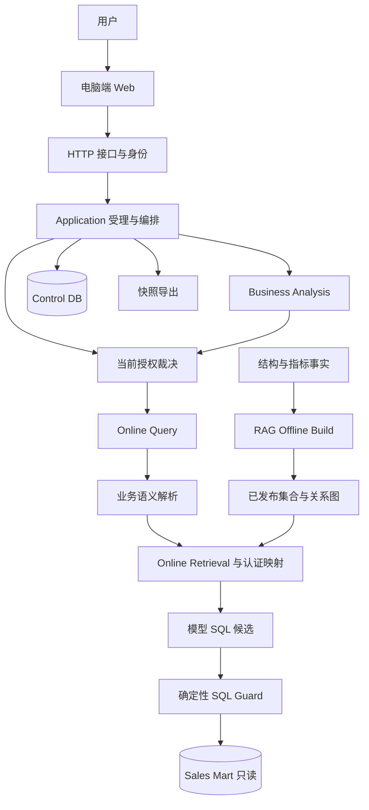
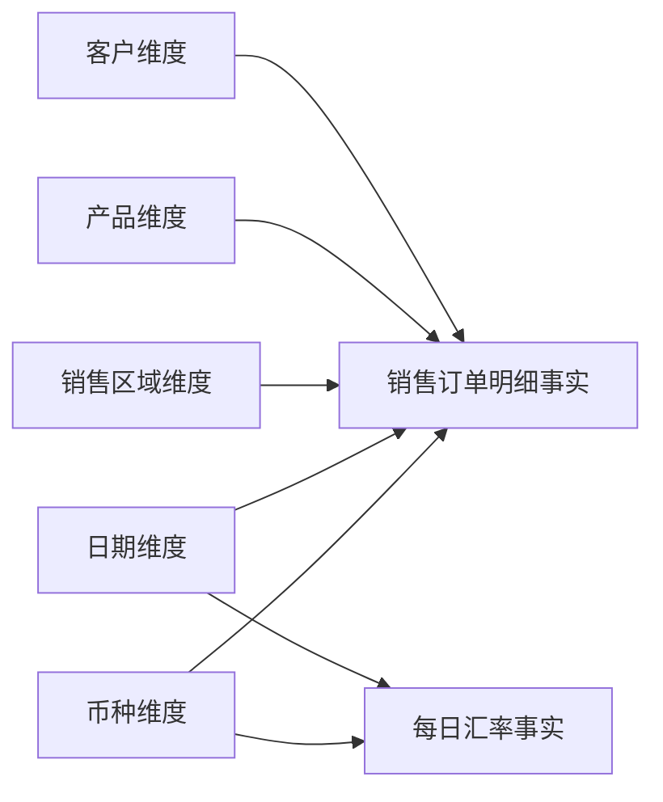
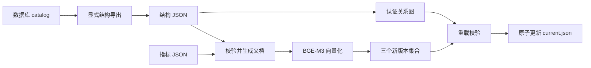
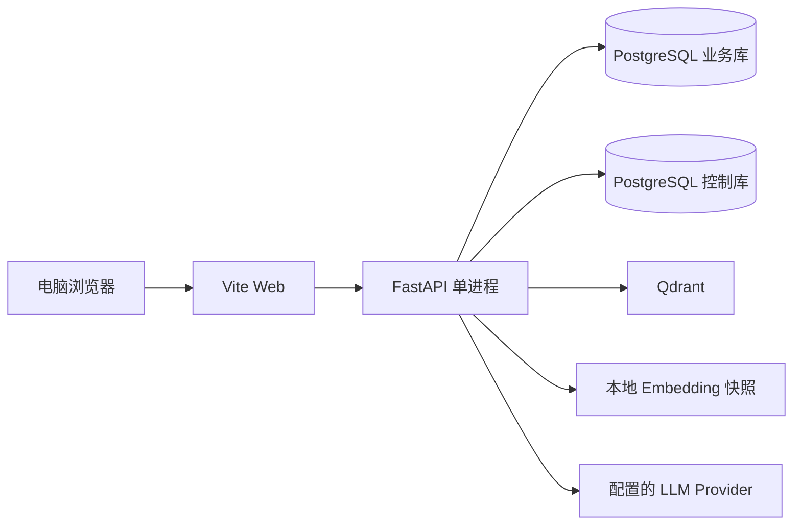

# ChatBI 项目全景详解

这是一份从头理解 ChatBI 的教学文档，适合项目负责人、首次阅读代码的开发者，以及希望完整讲解这个项目的人。阅读时可以先跟随具体业务问题理解系统，再看模块和目录，最后进入源码与运行验证。

本文的产品与代码讲解基准是 2026-10-20 冻结的 `baseline-20261020`，对应提交 `fa5dd6edbace8b866ddacbf1a9a50133d77d3468`。本文是基线之后新增的说明资料。示例中的问题、SQL 和计算数字用于解释机制，没有声称它们就是一次实际运行结果。

本文完整说明项目思路和主要机制；精确行为仍分别由[产品范围](product-scope.md)、[系统架构](architecture.md)、[正式 Spec](specs)和[运行手册](runbook.md)定义。代码发展时应同步维护相关讲解；如果出现差异，先按这些事实源核查，不能用本文的教学简化去改变业务规则。

## 阅读地图

推荐按以下顺序阅读。已经熟悉产品的人可以直接进入模块与源码部分。

1. [项目的出发点](#项目的出发点)：解决谁的什么问题。
2. [理解项目的四张地图](#理解项目的四张地图)：业务、架构、调用链与目录的关系。
3. [用户实际获得的能力](#用户实际获得的能力)：从登录到问数、分析、保存与导出。
4. [支撑整个项目的设计原则](#支撑整个项目的设计原则)：业务真相、模型与程序的分工。
5. [系统整体结构](#系统整体结构)：模块化单体及技术组件。
6. [销售数据与业务语义](#销售数据与业务语义)：事实表、维表、指标、日期口径与绑定。
7. [一次问数的完整过程](#一次问数的完整过程)：自然语言如何变成可信查询结果。
8. [RAG 的离线与在线两条路线](#rag-的离线与在线两条路线)：业务资料如何变成可检索上下文。
9. [多轮追问与完整条件恢复](#多轮追问与完整条件恢复)：如何继续问，又如何防止状态被污染。
10. [经营分析怎样工作](#经营分析怎样工作)：固定工作流与确定性归因。
11. [身份权限与数据安全](#身份权限与数据安全)：谁能进入链路、看什么、改什么。
12. [历史成果与执行状态](#历史成果与执行状态)：为什么存储、取消和恢复也是业务的一部分。
13. [结果展示与文件导出](#结果展示与文件导出)：把可信结果交给用户。
14. [模块职责与代码入口](#模块职责与代码入口)：从逻辑模块找到源码。
15. [仓库目录与文件的物理地图](#仓库目录与文件的物理地图)：区分代码、事实源、资产和证据。
16. [程序怎样启动和运行](#程序怎样启动和运行)：容器、装配、初始化和就绪。
17. [如何验证项目正确](#如何验证项目正确)：软件测试、AI 评测与业务验收。
18. [诊断问题与阅读源码](#诊断问题与阅读源码)：面对具体问题从哪里找。
19. [怎样维护和扩展项目](#怎样维护和扩展项目)：新增业务能力会影响哪些边界。
20. [当前完成范围与支持边界](#当前完成范围与支持边界)：冻结基线代表什么。
21. [常见术语](#常见术语)：阅读过程中随时查阅。
22. [把项目讲给别人听](#把项目讲给别人听)：一条可直接采用的讲解路线。

## 项目的出发点

### 业务问题

销售业务人员想知道“某个月卖了多少”“哪些产品贡献最大”“两个月毛利为什么变了”。传统方式通常需要理解报表入口、筛选条件、指标定义，或请懂 SQL 的人查询。ChatBI 让用户用自然语言表达这些问题，由系统完成业务理解和受控查询，并以表格、图表或分析报告呈现结果。

真正的难点在于：用户的一句话可能省略了业务口径，而同一个词也可能对应多个指标。数据库里有字段，并不代表系统已经知道它在当前业务中应该怎样计算；模型生成了一条能执行的 SQL，也不代表算的是用户所问的指标。

例如“销售额”必须回答：是人民币金额还是交易币种金额？按下单、确认还是完成日期？是否只统计完成的订单？折扣和汇率是否已经体现在数据中？这些规则要先由业务定义确定，才能让查询有可核对的含义。

### 产品定位

ChatBI 的定位是 Domain AI Engine，即围绕一个明确业务领域组织的 AI 引擎。当前领域是销售数据，当前数据来自单一 PostgreSQL Sales Mart。Web 是面向使用者的交互入口，后端引擎负责理解、检索、认证、查询、分析和状态裁决。

项目采用 Modular Monolith，即模块化单体：业务能力划分为有职责边界的模块，在当前单 API 进程的运行范围内协作。理解它时，既要看到用户产品，也要看到支撑产品的领域定义、受控执行和工程验证。

### 一句话解释它

可以向第一次接触项目的人这样说：

> ChatBI 让用户用自然语言查询销售数据、追问和分析变化；模型负责提出理解与查询候选，程序依据业务定义、当前权限和 SQL 安全规则决定是否执行，并保存可追溯的结果。

## 理解项目的四张地图

同一个项目可以从四个方向看。它们回答不同的问题，彼此需要对应。

| 视角 | 回答的问题 | ChatBI 中的例子 |
| --- | --- | --- |
| 业务能力 | 用户要完成什么？ | 问销售额、继续追问、分析毛利变化、下载报告 |
| 逻辑架构 | 谁负责这件事？谁拥有规则和状态？ | Authorization 管权限，Online Query 管一次问数，Application 管执行与成功状态 |
| 运行调用链 | 一次操作按什么次序发生？ | 认证 → 受理 → 语义解析 → 检索 → SQL 候选 → Guard → 查询 → 保存 |
| 目录文件 | 对应实现和资料放在哪里？ | `src/online_query/`、`frontend/`、`docs/specs/` |

“问数模块”是职责概念，`src/online_query/` 是主要实现位置。两者关系紧密，但没有要求一个能力只能占一个文件夹，也没有要求一个文件夹只能包含某一层的代码。

例如 `src/query_api/` 既有 HTTP Adapter，也有历史、执行和导出的 Application 实现。看到目录名含有 API，不能据此把目录里所有代码都理解为 HTTP 请求转换。

另外还可以画部署图，回答“哪些进程、容器和存储在运行”。一个逻辑模块不等于一个容器：Online Query、Authorization 和 Business Analysis 都可以在同一个 API 进程中工作；PostgreSQL 和 Qdrant 则是独立的基础设施服务。

因此，完整讲解的顺序是：先说业务，再走一个请求，然后解释职责，最后定位目录和文件。直接遍历文件名，很难解释它们为什么存在。

## 用户实际获得的能力

### 一条完整使用旅程

管理员创建使用账号，用户登录并完成适用的首次改密。之后可以在电脑端 Web 中选择问数或经营分析。

在问数模式，用户问“2025 年 3 月按产品统计销售额”。系统显示真实执行阶段，完成后展示结果、指标说明、表格和适用图表。用户继续说“改成毛利”，系统在上一成功查询条件上修订指标，再查询当前数据。

这段对话会形成私人历史。用户刷新页面、重新登录或服务重启后，可以重开已保存结果；继续追问时则重新进行当前身份和业务定义校验。用户也可以把某个成功结果另存为独立成果，下载 XLSX 或适用图表的 PNG。

在经营分析模式，用户明确给出两个时期和销售额或毛利目标。系统执行受控查询任务，计算产品和因素贡献，生成经过校验的报告；正式报告可以导出 PDF。

### 能力之间的关系

| 能力 | 给用户的价值 | 依赖的核心机制 |
| --- | --- | --- |
| 自然语言问数 | 用业务语言获取真实数据 | 语义解析、认证检索、SQL Guard、只读执行 |
| 多轮追问 | 逐步修改指标、时间、分组和筛选 | 最后成功的结构化条件、确定性合并 |
| 经营分析 | 解释两期销售额或毛利的变化构成 | 固定查询计划、产品归因、受校验总结 |
| 表格和图表 | 看清数值、趋势和分类差异 | 可信结果元数据、数值精度、图形规则 |
| 私人历史 | 找回问题与当时结果 | 账号归属、持久快照、完整恢复条件 |
| 独立成果 | 留下选中的成功结果 | 独立快照及来源信息 |
| 后台执行 | 看到阶段，断连后仍能观察 | 持久受理、操作幂等、GET / SSE |
| 取消与恢复 | 控制长执行，区分是否真正结束 | 服务端状态机、停止裁决、checkpoint |
| 文件导出 | 把可信结果交给后续工作 | 服务端成功快照、隔离生成与资源回收 |

完整能力与限制以[产品范围](product-scope.md)为准。

## 支撑整个项目的设计原则

### 业务定义先于模型输出

“人民币净销售额”怎样算、哪些订单应计入、使用哪个日期角色，由 Semantic 定义和权威数据决定。模型可以识别用户在问哪个指标，但不能自行修改公式或把含糊的“利润”解释为某个确定指标。

这对应 Business First 和 Domain Owns Business Truth：实现服务于业务含义，领域规则拥有最终解释权。

### 模型提出候选，程序决定

模型有三类主要作用：理解自然语言、提出 SQL、组织分析文字。它们的输出都要经过适用的结构与业务校验。

程序负责验证指标身份、时间、条件、表列、连接关系、公式、固定筛选和当前访问权限；经营分析中的金额、方向和贡献对账也由程序计算。Prompt 有助于引导模型，但真正的执行边界要落在确定性代码和数据库权限上。

### 核心稳定，外部技术可替换

业务语义、权限和成功状态的含义应保持稳定。LLM Provider、向量库客户端、HTTP 框架、文件生成库属于实现边界。替换技术时，应通过已有 Port / Contract 和 Adapter 接入，避免技术选择反向改变业务口径。

例如更换模型，需要验证新的候选仍能满足现有查询规则；不能为了使新模型输出通过而放松 SQL Guard。

### 以完整闭环控制复杂度

当前闭环从用户问题开始，到受控结果、状态保存、展示和导出结束。项目围绕已确认的销售场景建设能力，没有把“以后也许需要”当作引入多租户、分布式任务平台或任意 Agent 编排的理由。

模块化单体使这些能力可以在同一运行边界内直接协作，同时通过明确职责和测试防止模块相互侵入。以后扩大范围，需要先确认新的目标和验收，再决定是否调整架构。

## 系统整体结构

### 逻辑结构



图中表达主要职责关系，所有用户业务查询都必须经过当前授权入口。API、普通问数、经营分析内任务和 Evaluation 复用同一条正式查询链路。观测与诊断作为旁路记录真实阶段，不决定业务结果。

### 分层依赖怎样理解

项目遵循 `Interfaces → Application → Domain`，Application 依赖 Port / Contract，Infrastructure 提供 Adapter。

| 层次 | 应当处理什么 | 可以怎样理解 |
| --- | --- | --- |
| Interfaces | HTTP、身份输入、参数与响应转换 | 把用户和外部系统接到应用上 |
| Application | 用例编排、授权调用、生命周期、状态提交 | 决定一次工作怎样受控完成 |
| Domain | 指标含义、业务约束、语义与确定性归因规则 | 决定业务上什么是正确的 |
| Infrastructure | 数据库、模型、向量库、文件和观测 SDK 适配 | 提供执行这些工作的技术能力 |

这是一条职责和依赖规则，不要求源码必须存在四个同名的大目录。当前代码主要按能力分包，阅读时要根据文件内容辨认其层次。

### 运行时有哪些技术组件

| 组件 | 当前角色 | 需要把握的边界 |
| --- | --- | --- |
| React / TypeScript / Vite | Web 交互与开发构建 | 浏览器通过同源 API 使用系统 |
| FastAPI / Python | HTTP、应用服务与业务执行 | 当前为单 API 进程 |
| PostgreSQL Sales Mart | 销售事实及维度数据 | 业务查询账号只读 |
| PostgreSQL Control DB | 账号、权限、历史、执行、checkpoint | 使用独立运行身份，可写受控应用数据 |
| LLM Provider | 查询理解、SQL 候选、分析总结 | 输出始终需要校验 |
| BGE-M3 / FlagEmbedding | 业务文档与查询向量化 | 模型快照需要显式准备 |
| Qdrant | 检索发布的表、列和指标文档 | 检索命中不能替代业务认证 |
| LangGraph | 固定经营分析流程与 checkpoint | 恢复同一分析运行 |
| SQLGlot | SQL AST 解析与规则校验 | 检查候选 SQL 的结构和业务一致性 |
| ECharts | 可信结果的适用图形展示 | 绘图不重新查询或改写结果 |
| XlsxWriter / Playwright / Chromium | 服务端文件生成 | 只消费授权快照，隔离渲染资源 |
| OpenTelemetry | 真实链路的安全诊断 | 导出失败不得改变业务终态 |
| Docker / Compose / dev | 本机环境、依赖、初始化与验证入口 | 当前支持源码开发和本机体验 |

具体依赖由[Python 项目配置](../pyproject.toml)、[Python 锁文件](../uv.lock)、[前端配置](../frontend/package.json)及锁文件记录；本文按职责解释技术，不重复维护依赖版本清单。

## 销售数据与业务语义

### 事实表与维表

Sales Mart 是组织好的销售数据集。事实表记录发生了什么，维表描述相关业务对象。

核心事实表 `mart_sales.fct_sales_order_line` 的粒度是销售订单明细行。同一订单可以有多行，因此“订单数”“明细行数”和“销售数量”是三个不同概念：订单数按订单业务编号去重，明细行数按记录计数，销售数量对数量字段求和。

| 表 | 保存什么 | 在查询中的作用 |
| --- | --- | --- |
| `fct_sales_order_line` | 订单明细、状态、数量、人民币金额、日期键 | 销售指标的主要数据来源 |
| `dim_customer` | 客户名称、编码、类型、区域等 | 按客户属性查看数据 |
| `dim_product` | 产品名称、编码、产品线、类别等 | 产品分组与归因身份 |
| `dim_sales_region` | 销售区域 | 区域分组 |
| `dim_date` | 自然日期、年、季、月等 | 明确时间范围与时间分组 |
| `dim_currency` | 币种 | 描述交易币种 |
| `fct_exchange_rate_daily` | 日期与币种对应的汇率 | 保存汇率事实；已有人民币指标直接使用冻结金额 |



这里的线表示概念关联；实际外键由事实表指向维表，认证查询连接使用已登记的直接 FK→PK 关系。

### 日期角色为什么重要

一条销售明细可以有下单日期、确认日期和完成日期，它们都能指向同一张日期维表，但业务意义不同。问“3 月销售额”时，不能仅凭哪一条连接最容易生成就选哪一条。

当前登记指标使用完成日期口径，即 `completion_date_key → dim_date.full_date`。因此，认证映射和 Guard 必须约束日期连接角色。日期表一样、SQL 也能运行，并不能证明时间口径相同。

### 当前登记的指标

以下是基线中指标目录的教学概览；公式、固定筛选与日期说明由[指标事实源](../src/semantic/metrics.json)维护。

| 指标 | 核心含义 |
| --- | --- |
| 已完成订单数 | 已完成明细中按 `order_id` 去重计数 |
| 已完成订单明细行数 | 已完成明细的记录数 |
| 人民币净销售额 | 已完成明细的 `net_sales_amount_cny` 求和 |
| 人民币销售成本 | 已完成明细的 `sales_cost_amount_cny` 求和 |
| 已完成销售数量 | 已完成明细的 `quantity` 求和 |
| 人民币毛利 | 人民币净销售额减人民币销售成本 |
| 毛利率 | 同一范围的人民币毛利除以人民币净销售额，分母为零时返回 NULL |

“销售额”“营收”等登记别名可以认证为人民币净销售额。“利润”不能唯一确定时需要澄清。派生指标虽然记录了依赖关系，当前在线查询并不据此建设递归指标编译器；仍使用已经登记和认证的公式。

### 四类资料各自拥有什么事实

| 资料 | 拥有的内容 | 典型位置 |
| --- | --- | --- |
| 实际数据库 catalog 与结构投影 | 物理表、列、类型、键与关系 | PostgreSQL catalog、`src/structure/generated/` |
| Semantic | 指标定义、别名、公式、固定条件、时间和业务绑定 | `src/semantic/metrics.json`、`query_bindings.json` |
| 展示配置 | 单位、格式及展示属性 | `src/semantic/result_display.json` |
| 已发布检索资产 | 用于当前检索的完整版本与来源指纹 | Qdrant 集合、`data/rag/current.json`、manifest 与关系图 |

Structure JSON 是数据库结构的投影，不能靠手工改它就改变真实数据库。RAG 资产由事实生成，不能反过来定义新的业务口径。展示配置决定金额怎样显示，不能把毛利改成净利润。

物理模型见[Sales Mart DDL](../database/sales_mart/001_create_schema.sql)，数据归属见[系统架构](architecture.md)。

## 一次问数的完整过程

用“2025 年 3 月按产品统计销售额”说明一条完整请求。下面说明各阶段必须完成的工作，不保证模型每次产生完全相同的中间文字或 SQL 排版。

### 从 Web 到受理

用户在 Web 提交问题。服务端从当前 Session 或受支持的 Bearer 身份中建立可信身份上下文，而不是相信客户端提交的用户编号。网页业务请求还需要适用的 CSRF、归属、版本、占用和额度检查。

后台执行入口先持久化受理记录，再执行业务；受理成功返回执行身份。Web 此后通过 GET / SSE 观察状态。旧同步 Query API 仍保留，不能把“核心查询同步执行”和“网页异步受理与观察”混为一件事。

### 从自然语言到业务语义

Query Understanding 让模型提出结构化候选。基础候选包含 `query_type`、`subjects`、`metrics`、`dimensions`、`time`、`filters` 六类字段。例如这句话表达了：指标分析、销售额、按产品分组、2025 年 3 月。

这个阶段处理业务含义，不让模型直接把自然语言映射成数据库列。用户原话中的指标说法会保留，后续再由程序按登记名称或别名认证规范身份。

候选必须经过严格字段、类型、时间与范围校验。不能唯一解释的指标先返回澄清；模型返回非法 JSON 或违反候选 Contract，属于模型阶段失败，不能把它当作有效问题继续执行。

网页历史还要求保存完整条件，例如排序、业务 Top-N、实体选择和聚合后筛选。这些条件不能因为基础六字段示意中没有展示，就在实际执行和恢复时丢失。

### 从业务语义到认证上下文

本次请求固定一个已发布资产版本，检索相关指标、表和列，并确定认证的直接连接关系。

程序确认“销售额”对应人民币净销售额，公式是已登记聚合，固定筛选包含已完成状态，时间使用完成日期；“产品”对应权威绑定的产品字段。相关表列还必须存在于当前资产和本次查询上下文。

这一步形成可用于生成的最小上下文，同时保留程序可以直接使用的认证事实。Prompt 文本和程序认证数据有不同用途，程序不靠重新解析 Prompt 来找回业务身份。

### 从上下文到 SQL 候选

SQL Generator 接收受限上下文，为这次问题提出一条 PostgreSQL SQL。下面是一种说明结构的写法：

```sql
SELECT
    p.product_name,
    SUM(f.net_sales_amount_cny) AS net_sales_cny
FROM mart_sales.fct_sales_order_line AS f
LEFT JOIN mart_sales.dim_product AS p
    ON f.product_key = p.product_key
LEFT JOIN mart_sales.dim_date AS d
    ON f.completion_date_key = d.date_key
WHERE f.order_status = 'completed'
  AND d.full_date >= DATE '2025-03-01'
  AND d.full_date < DATE '2025-04-01'
GROUP BY p.product_name
ORDER BY p.product_name ASC NULLS LAST;
```

这里选择的是人民币净销售金额、已完成状态、完成日期和认证产品关系。这个教学 SQL 没有代表实际执行过，也没有给出虚构查询值。

### SQL Guard 为什么是必需步骤

Guard 使用 SQL AST，即解析后的语法树，检查语句结构、访问范围和适用业务约束。它不能只看 SQL 是否以 SELECT 开头。

当前规则包括单条、单层 SELECT，限定 `mart_sales`，表列存在，连接符合认证的直接关系，以及适用的指标公式和固定条件。网页可恢复查询还要对照事先认证的完整条件检查投影、时间、筛选、分组、排序和业务数量等。

例如，把完成日期换成下单日期、漏掉已完成筛选、用明细行数冒充订单数，可能依然得到一条可执行 SQL，但已经改变业务含义。应在执行之前拒绝，而不是看到结果有数字就当作成功。

Guard 不通过时返回受控拒绝，不执行数据库，也不会自动放宽规则或修复 SQL 继续尝试。

### 数据库执行与结果返回

通过校验的 SQL 使用只读业务账号执行。当前查询最多返回 100 行，执行端最多读取 101 行来判断是否截断；业务 Top-N 条件和这项取数上限是两个不同概念。

SQL 正常执行但没有匹配数据仍是成功，返回空结果；数据库异常和超时则返回明确错误。程序不得编造数据补齐结果。

成功执行后，程序基于已认证语义、实际 SQL 与权威配置生成适用的结果说明。网页历史还要求成功结果与完整续聊状态保存完成，才能对用户宣称成功。展示说明局部无法认证可以降级，必需的恢复状态或成功持久化失败则不能伪装为完整网页成功。

### 不同失败意味着什么

| 情况 | 典型结果 | 下一步含义 |
| --- | --- | --- |
| 问题为空或格式不合法 | `INVALID_REQUEST` | 用户修正输入 |
| “利润”等口径不唯一 | `CLARIFICATION_REQUIRED` | 明确业务口径后再提交 |
| 业务资源不足或关系无法支持 | `CANNOT_ANSWER` | 当前能力不能可靠回答 |
| 资产、Embedding 或 Qdrant 技术故障 | `CONTEXT_ERROR` | 修复上下文依赖 |
| 模型调用或输出 Contract 失败 | `LLM_ERROR` | 按实际阶段排查模型服务与输出 |
| SQL 结构或业务一致性不合法 | `SQL_REJECTED` | 保留拒绝，不能绕过 Guard |
| 数据库执行异常或超时 | `DATABASE_ERROR` / `QUERY_TIMEOUT` | 排查连接、执行与预算 |
| 查询结束但保存无法确认 | 历史 / 执行的未确认状态 | 不推进最后成功上下文 |

精确输入输出、错误码和时间预算见[在线查询 Spec](specs/online-query.md)、[Query API](specs/query-api.md)及[完整恢复 Contract](specs/query-restoration.md)。

## RAG 的离线与在线两条路线

### RAG 在这里解决什么问题

RAG 是 Retrieval-Augmented Generation，即检索增强生成。在 ChatBI 中，它为当前问题找出相关的业务和结构知识，形成 SQL 生成所需的有限上下文。

当前主要检索对象是 TABLE、COLUMN、METRIC 三类文档及确定性关系图。向量库帮助召回候选，程序继续核验指标身份和物理关系；向量相似并不自动证明某个指标正确。

这里主要检索的是结构与指标资料，不是把全部销售明细复制进向量库再让模型猜金额。实际数值来自经过安全校验的 PostgreSQL 查询。

### 离线路线：把事实制作成发布资产



结构导出和离线构建是两个步骤：导出工具读取实际 catalog 并生成结构 JSON；`rag_offline` 只消费已确认事实文件，不自行扫描业务数据库或修改它。

构建先校验源资料，生成三类文档，对检索正文做 Embedding，创建隔离的新 Qdrant 集合，并生成关系图。三个集合和关系图全部通过发布前校验后，才替换当前指针。

Metric 文档的检索正文用于识别指标，完整 metadata 保存公式、固定筛选、来源、时间等事实。关系图来自登记关系，不由向量相似性推断。

manifest 记录资产身份与输入指纹，使系统能核对索引是否对应当前结构、指标和 Embedding 配置。失败构建不覆盖当前发布指针；模型准备、结构导出和索引重建都需要显式执行。

### 在线路线：为一次请求选取最小上下文

请求固定同一个 AssetSnapshot，保证表、列、指标和关系图不混用版本。TABLE 与适用的 METRIC 召回后，COLUMN 检索限定在候选表范围内；必需资源选择和直接关系认证共同形成最小查询上下文。

实体查询没有指标，单指标和多指标分别有一个或多个指标，但都走统一的 `metrics=0/1/N` 流程。当前单次最多 5 个明确请求的指标，全部必须覆盖且相互兼容，不能静默丢项或增项。

已发布新版本供后续请求加载，本轮请求不在中途切换版本。技术故障按上下文错误失败关闭；显式静态评测模式另有用途，不能充当在线 RAG 故障时的全量 Schema 回退。

规则和机制分别见[在线检索 Spec](specs/online-retrieval.md)、[在线检索 Design](designs/online-retrieval.md)、[离线构建 Spec](specs/rag-offline-build.md)及[离线构建 Design](designs/rag-offline-build.md)。

## 多轮追问与完整条件恢复

### 追问继承什么

用户先问“2025 年 3 月按产品统计销售额”，再说“改成毛利”。下一轮需要保留 3 月和按产品分组，替换指标，并重新执行当前查询链。

Application 保存的是最后成功的结构化业务条件。模型提出本轮修改候选，程序按已确认规则合并：同槽位替换、不同槽位叠加，明确的维度替换按其语义处理，无法唯一确定时先澄清。

失败轮次、澄清或权限拒绝不替换最后成功状态。因此一次错误问题不会使后面的“继续按原来查”继承未经确认的条件。

### 为什么要保存完整条件

“销售额最高的前 10 个产品”除了指标和分组，还包含排序对象、方向和业务数量。只保存“销售额、产品”会在恢复时丢掉用户真正要的排名。

网页恢复状态覆盖当前支持范围内的排序、Top-N、实体输出与去重、聚合后筛选，以及指标、维度、时间和行筛选。条件使用规范业务身份，不保存任意 SQL 片段作为可直接执行的规则。

相对时间在当次校验后转为带时区的绝对范围。重开旧结果不会把当时的“最近一个月”无提示变成今天重新解释的一段时间。

### 短期会话与持久历史

| 对象 | 用来解决什么问题 | 关键性质 |
| --- | --- | --- |
| 旧同步 API 的短期会话 | 进程内连续追问 | 无成功更新 30 分钟后过期，不承担长期历史职责 |
| 网页问数历史 | 跨刷新、登录和重启查看或继续 | 保存结果快照与完整条件，续聊时重新认证 |
| 分析 checkpoint | 恢复同一次未完成分析 | 独立运行身份与 24 小时期限 |

延长短期 TTL 不能替代持久历史；长期保存报告也不能依赖 checkpoint 永远存在。

### 旧状态为什么要重新认证

历史状态只能说明当时成功过。现在使用它续聊或重查，还要检查当前用户、当前指标定义、字段映射、类型与 Join 不变量。

程序比较与该查询有关的业务定义；仅仅发布了新的全局资产版本，不代表旧条件一定不兼容。反过来，相关公式或映射真的改变时，也不能因为历史记录存在就继续使用旧 SQL。

重开结果读取当时快照，续聊执行合并后的条件，显式重查从原完整条件建立新查询。三种操作的目标不同，旧快照保持其当时含义。

详见[完整恢复 Contract](specs/query-restoration.md)及[历史设计](designs/history-results-v1.md)。

## 经营分析怎样工作

### 它回答哪一种问题

当前经营分析聚焦于两个明确时期之间的人民币净销售额或毛利变化。用户需要明确两个时期；系统按产品解释哪些产品贡献了变化，再计算价格、销量及适用成本因素的贡献。

例如“2025 年 3 月毛利为什么比 2 月下降”，表达的是一个待核验的问题，下降是用户的预设。系统必须先查询真实方向；如果实际是上升，应以真实结果纠正预设。

经营分析与普通问数模式分开。普通问数适合查询、分组和连续修订；经营分析执行固定的两期归因流程，不继承普通问数会话，也不根据模型想法自动增加区域或客户拆解。

### 固定流程与模型分工


LangGraph 编排这些节点。LLM 帮助识别目标与时期，程序生成固定任务；每个数据查询任务仍走当前授权的 Online Query 链路。查询任务得到数据后，程序计算贡献，Summary LLM 根据这些结果组织说明。

模型不能增加未确认的分析维度，不能计算或改写最终金额，也不能把无法观测的采购、市场或策略变化写成已经证实的原因。这里的归因解释的是数据变化的构成，不等于证明现实中的深层因果关系。

任一必需查询失败、数据截断或贡献对账失败，都不能生成完整原因结论。模型总结本身调用或校验失败，也不能被查询成功掩盖。

### 用数字理解因素归因

以下是一个虚构产品的教学例子，金额单位为元：

| 量 | 上期 | 本期 |
| --- | --- | --- |
| 销量 `q` | 10 | 12 |
| 实际成交单价 `p` | 100 | 110 |
| 单位成本 `u` | 60 | 65 |
| 销售额 `p × q` | 1000 | 1320 |
| 毛利 `(p − u) × q` | 400 | 540 |

实际毛利增加 140。按对称分摊法：

- 单价贡献：`(110 − 100) × (10 + 12) / 2 = 110`。
- 销量贡献：`(12 − 10) × ((100 − 60 + 110 − 65) / 2) = 85`。
- 单位成本贡献：`−(65 − 60) × (10 + 12) / 2 = −55`。

三项合计 `110 + 85 − 55 = 140`，必须与真实差额相同。成本上涨对毛利是负贡献，展示时不能因为“成本增加”这个词是增加，就画成对毛利的正贡献。

实际成交单价取人民币净销售额除以销量，单位成本取人民币销售成本除以销量。系统不直接把跨币种交易单价混在一起比较。

只在一期出现的产品，没有可比较的两期单价或成本，应单列新增或退出产品贡献，不能补造另一时期的价格再硬分配。产品贡献合计还必须与整体变化对上。

### 分析恢复

`analysis_run_id` 标识同一次分析运行，并作为 LangGraph 的 `thread_id`。同一合法用户以相同运行 ID 和相同问题，可以在有效期内手动恢复未完成运行；不同用户或问题不能复用该身份。

checkpoint 保存恢复同一运行需要的受控工作流状态，保留期限为 24 小时。完成报告另存为历史快照后，不依赖 checkpoint 继续存在。已经取消的分析不能按原任务继续恢复，用户需要明确新建。

部分暂时性基础设施故障有任务级受控重试，权限拒绝、澄清和 SQL 安全拒绝不能据此盲目重试。页面刷新也不会自动恢复一次分析。

精确场景、公式、恢复和报告规则见[经营分析 Spec](specs/business-analysis.md)。

## 身份权限与数据安全

### 认证与授权分别做什么

认证回答“当前是谁”，授权回答“这个身份现在可以做什么”。前端显示了某个按钮，不代表服务端可以省略对应检查；记录编号、旧历史或已保存状态也不能充当权限证明。

浏览器通过 HttpOnly Cookie 携带登录凭证，服务端检查数据库 Session、账号状态、权限和期限；Cookie 业务操作还要经过 CSRF 防护。旧 Bearer 接口继续兼容。身份来源发生冲突时按规则拒绝，不静默切换成另一个用户。

每轮问数、每个分析任务、历史访问和导出都使用适用的当前授权检查。权限撤销、账号禁用或会话失效后，旧页面不能继续交付私有结果。

### 当前角色和数据范围

固定 RBAC 包含 `admin` 和 `analyst`。管理员角色具有查询及账号、角色权限、审计管理等固定权限；分析用户角色具有查询权限。精确目录见[RBAC 种子定义](../database/control/002_seed_rbac.sql)。

当前指定用户共享同一套销售业务数据，私人历史和成果按账号隔离。因此，“只能看自己的历史”与“只能查询自己部门的数据”是两种不同能力；当前没有部门、区域的行列级数据隔离。

管理员负责创建账号，没有公众自助注册。首次改密、改密后撤销旧 Session、登录期限和可信本机管理员恢复，都有单独的行为约定。

### 两个数据库身份为什么分开

销售业务连接以只读身份访问 `mart_sales`，即使模型提出写操作，Guard 和数据库权限也分别提供约束。Control DB 则保存应用自己的受控数据，需要使用独立账号写入用户、Session、历史、执行和 checkpoint。

这让“应用需要保存状态”和“用户查询必须只读”可以同时成立。迁移所需的高权限身份只用于初始化工具，不能因为运行方便就交给在线查询。

### 安全还有哪些落点

SQL 安全由解析与认证规则承担，结果文本按不可信内容展示，XLSX 文本不转成可执行公式，导出 renderer 不接受客户端文件路径或任意外网资源。日志、Trace、错误响应和工作记录不应包含真实 Secret。

这些规则分布在各能力的自然边界：身份模块处理身份，Guard 处理 SQL，历史处理 owner，导出处理快照访问和生成资源。安全不是依赖一句 Prompt 完成的。

相关定义见[Web Spec](specs/web-dialogue-v1.md)、[Query API](specs/query-api.md)、[历史 Spec](specs/history-results-v1.md)及[管理员恢复 Spec](specs/admin-recovery.md)。

## 历史成果与执行状态

### 几种身份不能混用

| 标识或对象 | 表达什么 |
| --- | --- |
| `request_id` | 一次请求的业务关联编号 |
| `trace_id` | 一次实际诊断链路 |
| `conversation_id` | 旧同步 API 的短期问数会话 |
| `history_id` 与轮次 | 用户的持久对话或分析历史，以及其中某次提交 |
| `operation_id` | 一次提交操作，用于避免受理响应丢失后重复执行 |
| `execution_id` | 一次实际执行尝试及其状态 |
| `analysis_run_id` | 可恢复的同一次分析运行 |
| 保存成果 | 用户选定成功结果的独立快照 |

同一分析运行可以有不同恢复请求和执行尝试；同一提交操作的幂等重放则应找回原执行。Trace 不能代替这些业务身份。

### 历史和成果的区别

历史自动记录已认证、已受理的网页问题与轮次，包含成功或受控非成功状态。成功结果保存当时的公开数据、原始值、说明和适用完整条件。

成果由用户明确选定成功轮次或完成报告保存，是独立快照。原历史后来继续追问或被删除，不改变已经保存的成果；成果删除也不删除原历史。两者保留到用户主动删除，不能依靠短期会话缓存实现。

重开历史与成果默认只读。要查最新数据，用户应明确选择续聊或重查；系统不能在用户只是查看旧结果时悄悄调用模型和数据库。

### 为什么执行要先受理再观察

模型、检索和分析可能需要时间。后台入口先保存“已接受这次操作”的事实，再开展实际业务，浏览器通过状态查询和 SSE 观察进度。

同一操作编号和同一内容只对应一次执行。如果 POST 响应丢失，客户端按操作编号找回原执行；不能仅凭没收到响应就换编号再发一次。网页刷新或 SSE 重连也只观察已有执行。

SSE 是服务端向浏览器发送阶段与内容增量的通道。它可以显示真实阶段和标注为未校验的报告草稿，但草稿尚未成为正式报告；校验和保存成功后，才有可交付、可保存或可导出的正式结果。

### 取消为什么有中间状态

用户点击取消，只能说明服务端接受了停止要求，不代表模型调用、数据库工作或 worker 已经退出。因此需要区分“正在取消”和“已取消”。

超时也一样：保护时限到了，先要求停止，确认实际工作结束后才能释放资源和裁决终态。若无法证明已经停止或成功提交，应保留“结果未确认”等真实状态。

同一历史的并发提交、旧版本上下文、服务重启和迟到结果都受服务端裁决。epoch / generation 等版本机制用于防止旧执行覆盖新状态，不能依赖页面自己忽略响应来保证持久化正确。

### 成功包含状态提交

对于网页持久历史，查询得到行或模型返回报告，只完成了部分工作。正式成功还需要通过相应校验，并把结果和适用续聊条件可靠保存。

如果保存失败，不能页面说成功、刷新却找不到结果，也不能让下一轮继承一个没有提交的上下文。这个要求使状态一致性成为产品行为的一部分。

完整定义见[历史与成果](specs/history-results-v1.md)、[后台执行 Spec](specs/execution-streaming-v1.md)及[执行设计](designs/execution-streaming-v1.md)。

## 结果展示与文件导出

### 查询结果怎样获得业务含义

数据库返回列和值，业务展示还需要知道列代表哪个指标、单位是什么、使用哪个时间范围、是否截断。服务端的 `result_metadata` 基于已认证事实生成，不能根据 SQL 别名猜“这列一定是金额”。

可信单值指标可以展示指标卡；单一时间维度适合折线图；单一分类维度适合柱状图；多个业务分组或语义不足时保留表格。图表规则不擅自汇总重复分组，也不把缺失时段补成零。

零、NULL、空字符串和没有结果分别表达不同含义。截断数据只能说明实际返回范围，不能据此宣称整体排名、完整占比或完整总额。

前端的单位、舍入和显示排序服务于阅读，不能改变后台指标或续聊状态。高精度数值的文本处理与图形近似分开，不能让 JavaScript Number 的转换悄悄损失原值。

### 导出从哪里取数据

| 格式 | 来源与用途 | 核心要求 |
| --- | --- | --- |
| XLSX | 成功查询快照 | 保留原始返回值、列行顺序及说明，处理精度与危险文本 |
| PNG | 快照中适用的一张图 | 包含所选图的已有数据、单位与适用限制 |
| PDF | 已完成且校验通过的分析快照 | 包含正式正文、归因、引用证据和限制说明 |

服务端重新核验当前 owner 与权限后，从持久化成功快照生成文件。客户端只选择来源与允许的图形，不提交权威结果值、SQL、文件路径或任意图表配置。

导出不重查业务、不调用模型、不扩大到全量数据。页面图表切换和报告折叠不能让 PDF 漏掉应包含的正文与证据。生成前和发送前还有适用的访问裁决点，以处理权限撤销与来源删除的竞态。

XLSX 由 Python 文件 Adapter 生成；PNG / PDF 使用固定本地资源、模板、字体和受隔离的 Chromium。生成失败、超时或无法保证完整内容时受控失败，并回收工作进程和临时文件。

正式展示与文件规则见[结果可视化](specs/result-visualization-v1.md)、[导出 Spec](specs/result-export-v1.md)及[导出 Design](designs/result-export-v1.md)。

## 模块职责与代码入口

下面按职责组织代码地图。入口用于继续阅读，不表示某一个文件独自拥有整个能力。

| 模块或能力 | 主要负责什么 | 主要入口 |
| --- | --- | --- |
| Web | 登录、问数与分析界面、历史、结果和执行观察 | [App.tsx](../frontend/src/App.tsx)、[Chat.tsx](../frontend/src/Chat.tsx)、[Analysis.tsx](../frontend/src/Analysis.tsx) |
| HTTP Adapter | 路由、请求校验、身份提取、响应转换 | [app.py](../src/query_api/app.py)、[execution_api.py](../src/query_api/execution_api.py)、[history_api.py](../src/query_api/history_api.py) |
| Authorization | 认证、固定 RBAC、审计、当前授权查询入口 | [auth_service.py](../src/authorization/auth_service.py)、[rbac.py](../src/authorization/rbac.py)、[query_entry.py](../src/authorization/query_entry.py) |
| Online Query | 一次有效问数的阶段编排 | [service.py](../src/online_query/service.py)、[service_execution.py](../src/online_query/service_execution.py) |
| Query Understanding / Semantic State | 候选结构、校验、完整条件认证与当前映射 | [query_understanding.py](../src/online_query/query_understanding.py)、[semantic_state.py](../src/online_query/semantic_state.py) |
| Online Retrieval | 版本快照、表列指标候选、直接关系与上下文 | [retrieval_pipeline.py](../src/online_query/retrieval/retrieval_pipeline.py)、[rag_runtime.py](../src/online_query/retrieval/rag_runtime.py) |
| SQL Guard / Database | SQL AST、适用业务一致性、只读执行 | [sql_guard.py](../src/online_query/sql_guard/sql_guard.py)、[database.py](../src/online_query/database.py) |
| Multi-Turn Application | 短期状态、修订候选与受控合并 | [conversation.py](../src/query_api/conversation.py)、[semantic_revision.py](../src/query_api/semantic_revision.py) |
| History / Execution Application | 持久历史、成功状态、受理、观察、取消 | [history.py](../src/query_api/history.py)、[execution.py](../src/query_api/execution.py)、[execution_runtime.py](../src/query_api/execution_runtime.py) |
| Business Analysis | 固定工作流、查询计划、归因、报告与恢复 | [application.py](../src/business_analysis/application.py)、[planning.py](../src/business_analysis/planning.py)、[attribution.py](../src/business_analysis/attribution.py)、[reporting.py](../src/business_analysis/reporting.py) |
| Result Export | 快照访问、生成额度与格式 Adapter | [export_application.py](../src/query_api/export_application.py)、[export_runtime.py](../src/query_api/export_runtime.py)、[export_xlsx.py](../src/query_api/export_xlsx.py)、[export_png.py](../src/query_api/export_png.py)、[export_pdf.py](../src/query_api/export_pdf.py) |
| Control DB | 应用数据模型与持久化 Adapter | [models.py](../src/chatbi_control/models.py)、[history.py](../src/chatbi_control/history.py)、[execution.py](../src/chatbi_control/execution.py) |
| Semantic / Structure | 指标、绑定、展示属性与结构投影 | [semantic](../src/semantic)、[structure](../src/structure) |
| RAG Offline | 校验事实、文档与向量、关系图、版本发布 | [build.py](../src/rag_offline/build.py)、[documents.py](../src/rag_offline/documents.py)、[provenance.py](../src/rag_offline/provenance.py) |
| Bootstrap | 资源装配、生命周期、准备、就绪和诊断 | [runtime.py](../src/bootstrap/runtime.py)、[lifecycle.py](../src/bootstrap/lifecycle.py)、[readiness.py](../src/bootstrap/readiness.py)、[doctor.py](../src/bootstrap/doctor.py) |
| Observability | 安全 Span、失败分类和外部导出 | [tracing.py](../src/observability/tracing.py)、[tracing_safety.py](../src/observability/tracing_safety.py)、[tracing_export.py](../src/observability/tracing_export.py) |
| Evaluation | 正式链路的固定案例、评分与报告 | [suites](../evaluation/suites)、[common](../evaluation/common) |

### 几个值得先认识的入口

`AuthorizedQueryService` 负责把当前授权与下游查询连接起来；绑定身份的 Evaluation 也通过相应入口调用。直接看到 `OnlineQueryService.execute()`，应理解为授权之后的内部执行能力，不能拿它替代用户入口。

`HistoryApplication` 处理用户历史用例，`ExecutionApplication` 处理受理与执行尝试，`BusinessAnalysisApplication` 编排经营分析。它们用同一条问数能力处理数据查询，分别拥有各自的状态职责。

`contracts.py`、`result_contracts.py` 等文件通常定义模块之间交换的数据与协议。它们可以帮助读者先理解输入输出，再进入实现分支；文件名相近并不代表应该合并为一个通用 Contract。

`src/bootstrap/runtime.py` 是装配入口之一：它选择具体 Adapter 并建立运行依赖。模块使用被注入的能力，业务规则不应反过来调用 Bootstrap 来查找数据库或模型。

## 仓库目录与文件的物理地图

### 顶层布局

```text
chatbi-engine/
├── README.md                    人类阅读总入口与简短导航
├── AGENTS.md                    AI 协作规则
├── dev                          本机开发与验证统一入口
├── pyproject.toml / uv.lock      Python 依赖声明与锁定
├── frontend/                    Web 源码、构建、图形与浏览器测试
├── src/                         Python 业务与应用模块
├── database/                    Sales Mart DDL、控制库迁移与开发数据
├── data/rag/                    本机发布的检索资产与当前指针
├── evaluation/                  模型案例、运行器、评分与报告逻辑
├── tests/                       软件行为、集成与架构测试
├── scripts/                     开发命令、检查与验证工具
├── docker/                      开发依赖镜像及容器支持文件
├── docker-compose.yml           基础设施服务定义
├── docker-compose.dev.yml       开发 API、Web、工具与迁移服务
├── docs/                        当前正式文档、教学说明与审计
├── .github/                     PR 模板、CI 与自动合并工作流
├── .harness/                    工程任务控制的项目适配
└── .scratch/                    工作项规划、过程与历史证据
```

这是供理解的主要布局，不是包含全部本机缓存的目录枚举。`.env`、模型缓存、运行目录和原始报告具有不同的本机生命周期，不能看到它们就在某台机器上存在，就认为新 clone 也一定具备。

### src 怎样组织

```text
src/
├── authorization/       账号、授权、审计与授权查询入口
├── bootstrap/           初始化、装配、生命周期与诊断
├── business_analysis/   固定分析工作流与归因
├── chatbi_control/      受控应用数据持久化
├── observability/       安全链路诊断
├── online_query/        单次问数与认证执行
│   ├── retrieval/       在线 RAG
│   └── sql_guard/       SQL 安全与适用业务一致性
├── query_api/           HTTP 以及相关 Application 用例
├── rag_offline/         检索资产构建
├── semantic/            指标与业务语义事实
└── structure/           结构投影与运行结构适配
```

这张图说明为什么不能用“上层文件夹就是一层架构”理解项目：`query_api` 同时承载多个相关用例，`online_query` 又包含检索和 Guard 子能力。逻辑职责由 Contract、依赖和实现共同界定。

### 前端目录应怎样读

从 `frontend/src/main.tsx` 到 `App.tsx` 看应用入口，再按功能阅读 `Chat.tsx`、`Analysis.tsx`、`HistoryPanel.tsx`。`api.ts` 处理请求边界，`execution.ts` 与 `executionStream.ts` 处理执行观察。

`resultMetadata.ts`、`numberFormat.ts`、`chartPlan.ts`、`chartOptions.ts` 等文件帮助判断结果如何安全解释和绘制；`frontend/src/export/` 是导出专用模板与样式的一部分，不等于用户浏览器当前页面的截图。

### 文件按性质分为哪些类

| 类别 | 代表位置 | 阅读或修改时要注意 |
| --- | --- | --- |
| 产品实现 | `src/`、`frontend/src/` | 看职责、输入输出、状态和依赖 |
| 业务定义 | `src/semantic/`、Sales Mart 定义 | 先确认业务口径，不能只改生成 SQL |
| 结构投影 | `src/structure/generated/` | 应与实际 catalog 核对，通过导出流程更新 |
| 派生检索资产 | `data/rag/`、Qdrant 版本集合 | 由构建发布，不手改来绕过来源校验 |
| 验证逻辑和案例 | `tests/`、`evaluation/`、`frontend/tests/` | 区分软件行为与真实模型表现 |
| 当前文档 | `docs/architecture.md`、`docs/specs/` 等 | 按归属找到权威规则 |
| 历史与过程 | `.scratch/`、`docs/audits/` | 绑定当时基线，不当作当前启动教程 |
| 本机运行和证据 | `.env`、`.model-cache/`、`.local/`、`reports/` | 不随普通 clone 完整分发，Secret 不进入 Git |
| 工程控制状态 | `.harness/` 与 Git 公共目录的实时记录 | 管工程协作，不是产品会话或业务库 |

`docs/specs/` 是产品行为 Contract；`.scratch/<work-item>/spec.md` 是某次工作的规划与决定记录。理解当前行为应先看正式 Spec，追溯为什么做过某次改动再看工作记录。

## 程序怎样启动和运行

### 一套本机运行环境

当前统一从 WSL / Linux Bash 使用 `./dev`。Docker 镜像提供 Python、Node、浏览器和字体等依赖，Compose 组织 API、Web、PostgreSQL 与 Qdrant。



业务库与控制库可以由同一本机 PostgreSQL 服务承载，但数据职责和运行身份分离。外部 LLM 服务位置由本地安全配置决定，不能从目录结构推断具体 Provider。

### 第一次准备为什么有多个步骤

第一次使用需要从安全模板准备本地配置，填写模型连接与必要随机凭据，并保留已有配置。初始化顺序是：

```bash
./dev build
./dev infra
./dev migrate
./dev create-admin --username admin-1
./dev prepare-model
./dev build-rag
./dev up
```

| 步骤 | 准备什么 | 为什么显式执行 |
| --- | --- | --- |
| build | 源码开发与测试所需依赖镜像 | 依赖构建不应隐藏在普通启动中 |
| infra | PostgreSQL 与 Qdrant | 后续准备需要可访问的存储服务 |
| migrate | 控制库与 checkpoint 等迁移 | 应用启动前需要合法结构 |
| create-admin | 首个管理员 | 密码由交互输入，不在种子中固定 |
| prepare-model | 固定 revision 的本地 BGE-M3 快照 | 在线运行缺模型时不隐式联网下载 |
| build-rag | 检索集合、关系图与发布指针 | 需要证明资产完整且来源相符 |
| up | API 与 Web 等常驻服务 | 运行既有环境，不自动补齐全部初始化 |

新空开发卷会准备合成 Sales Mart 演示数据，日常启动不会重复播放 Seed。默认从 `http://127.0.0.1:5173` 体验，端口和完整配置步骤以[Runbook](runbook.md)为准。

### 装配与资源生命周期

[API 入口](../src/query_api/main.py)通过 Bootstrap runtime 创建应用依赖，再交给 `create_app`。具体资源在外层构造，应用通过已知协议使用；启动失败应回收已经打开的资源。

源码挂载用于开发，后端自动重载、前端热更新。依赖和锁文件变化后需要重新 build，环境配置变化需要按运行手册应用；代码重载不能保证进程内短期会话仍在，持久历史承担跨重启保存职责。

常驻容器采用 `unless-stopped`：已经运行的服务可随 Docker 恢复，主动停止后保持停止，直到显式启动。它不会替用户自动完成迁移、创建账号、下载模型或构建索引。

### 存活、就绪和模型状态

`/health` 说明 HTTP 服务存活，`/ready` 校验应用依赖与业务 / RAG 资产是否满足受理条件。服务启动了，不等于已经可以安全问数。

模型状态参考近期真实调用；没有近期证据时可以是 unknown，不通过定时收费探测来假装确定可用。就绪失败时拒绝新业务受理，不能编造已受理任务的终态。

同步与后台问数、分析共享当前业务额度，导出单独管理额度。额度和时限是保护边界，不是多用户容量或响应速度的保证。

`./dev doctor` 用于只读诊断已选环境，`./dev status` 查看服务状态。当前运行规则见[源码运行边界](specs/container-deployment.md)、[容器开发](specs/container-dev-environment.md)、[Bootstrap](specs/bootstrap.md)与[就绪保护](specs/application-readiness.md)。

## 如何验证项目正确

### 为什么需要三类证据

| 证据 | 主要回答 | 例子 | 单独不能证明什么 |
| --- | --- | --- | --- |
| Software Test | 程序规则是否按预期执行？ | 非法 SQL 被拒、失败不推进状态、取消不提前释放额度 | 真实模型在全部业务说法上都表现正确 |
| AI Evaluation | 当前模型与上下文在固定问题上表现如何？ | 单轮执行准确率、多轮条件修订、经营分析报告校验 | 所有页面、权限竞态和实际容器运行都正确 |
| Business Acceptance | 用户目标是否在真实链路完成？ | 登录 → 问数 → 追问 → 重开 → 导出 | 任意未来场景、容量和部署环境都已验证 |

三者共同提供证据，但覆盖对象不同。一个 API 返回 200 不足以证明指标口径正确；模型评测全过也不能替代历史持久化或账号撤权测试。

### 软件检查与测试

`tests/` 按能力组织后端测试，包括授权、查询、检索、Guard、历史、执行、分析、存储和模块边界。浏览器测试在 `frontend/tests/`；数据库和 renderer 有真实依赖的定向测试。

常用统一入口：

```bash
./dev check
./dev test python
./dev test database
./dev test web
./dev test renderer
./dev test all
```

`test all` 汇总相应软件套件，不调用真实 LLM。隔离测试资源与应用日常数据分开，报告还要说明适用源码和清理结果。精确检查范围以脚本和[Runbook 验证说明](runbook.md#3-验证与ci)为准。

### AI Evaluation

`evaluation/suites/` 包含单轮、查询理解、多轮和经营分析等套件，`evaluation/common/` 提供共享报告与身份能力。正式评测复用业务链路和适用当前授权入口，不维护另一套“更容易得高分”的 SQL 生成逻辑。

```bash
./dev evaluate --online-retrieval
./dev evaluate --query-understanding
./dev evaluate --multi-turn --online-retrieval
./dev evaluate --business-analysis --online-retrieval
```

真实模型运行需要已准备的资源和显式执行，会产生调用费用。报告记录实际提交、案例集、模型配置身份、RAG 版本及适用数据身份。

报告开始和结束还要核对来源是否稳定：运行中代码或输入改变的报告可以用于诊断，不能称为正式 clean 候选验收。旧分数只证明旧报告记录的条件，不自动延伸到新模型或新代码。

### 业务验收与 CI

`./dev verify dev` 提供真实业务验收入口，默认采用隔离资源，会调用真实 LLM。它与日常软件测试用途不同，具体场景与清理要求见[运行手册](runbook.md)。

[CI 工作流](../.github/workflows/ci.yml)执行仓库配置的确定性检查；[Real E2E](../.github/workflows/real-e2e.yml)另有显式触发入口。绿色 CI 说明已配置检查通过，不能代替未运行的真实评测、业务验收或公网运行验证。

原始报告主要位于本机 `reports/`，不保证随 clone 分发。长期工作记录保存验收摘要、适用提交和报告身份，不能把历史证据改名当作新结果。

正式评测规则与机制见[Evaluation Spec](specs/evaluation.md)及[Evaluation Design](designs/evaluation.md)。

## 诊断问题与阅读源码

### 先定位失败阶段

诊断从用户可见状态、`request_id`、`trace_id` 和实际阶段开始，先判断是业务澄清、范围拒绝、技术失败，还是执行结果未确认。

Trace 记录真实发生的节点，例如检索、模型生成、Guard 和数据库执行。Guard 拒绝后不应出现真正的数据库执行节点；观察系统不应因为自身导出失败而让业务查询失败或重试。

默认诊断不采集完整问题、Prompt、SQL、结果、Secret 或敏感异常。外部 OTLP 是否实际收到 Trace，需要真实收件证据；配置存在或导出函数返回，不足以证明平台可查询。

| 现象 | 优先阅读 | 先核查的事实 |
| --- | --- | --- |
| 指标含糊或被替换 | Query Understanding、Semantic、Retrieval | 用户说法是否登记、是否唯一、认证到哪个指标 |
| 金额或日期口径错误 | 指标定义、semantic_state、Guard | 公式、固定状态、完成日期角色是否一致 |
| 检索上下文不可用 | rag_runtime、离线 manifest、readiness | 同一版本资产是否完整，来源是否匹配 |
| 追问丢条件 | semantic_revision、恢复 Contract、历史状态 | 最后成功完整条件及 delta 合并结果 |
| 刷新后结果不一致 | HistoryApplication、Control DB Adapter | 快照是否提交，页面是否错误重发 |
| 取消后仍占资源 | ExecutionApplication、runtime、执行控制 | 实际工作是否已结束，终态是否可证明 |
| 图表单位或精度异常 | result_metadata、前端格式和图形规则 | 列是否认证、原始值和显示值是否混淆 |
| 导出缺内容或失败 | 导出 Application、renderer、资源清理 | 来源快照、访问裁决、完整性和运行依赖 |
| API 存活但不能问数 | Bootstrap readiness、doctor | 控制库、业务库、Qdrant、模型与资产状态 |

### 建议的源码阅读路线

第一次阅读，按以下顺序逐步建立模型：

1. 读[产品范围](product-scope.md)和[架构](architecture.md)，明确当前目标和边界。
2. 读[QueryRequest / QueryResult](../src/online_query/contracts.py)与[SemanticQuery 校验](../src/online_query/query_understanding.py)，掌握关键输入输出。
3. 读[授权查询入口](../src/authorization/query_entry.py)和[OnlineQueryService](../src/online_query/service.py)，串起一条问数。
4. 沿[Retrieval 流水线](../src/online_query/retrieval/retrieval_pipeline.py)、[semantic_state](../src/online_query/semantic_state.py)、[SQL Guard](../src/online_query/sql_guard/sql_guard.py)看认证发生在哪里。
5. 读[执行辅助](../src/online_query/service_execution.py)、[数据库 Adapter](../src/online_query/database.py)和[结果元数据](../src/online_query/result_metadata.py)，理解执行与返回。
6. 再读[HistoryApplication](../src/query_api/history.py)、[ExecutionApplication](../src/query_api/execution.py)和[业务分析 Application](../src/business_analysis/application.py)，理解外层用例。
7. 从[Web App](../frontend/src/App.tsx)阅读相应页面、API、执行观察与结果展示。
8. 对照同能力测试中的正常、边界和失败案例，检查自己的理解。

这是阅读顺序，实际请求按所用入口和用例编排执行，不会机械地把上面所有文件各调用一次。

### 文档之间怎样配合

| 想知道什么 | 优先文档 |
| --- | --- |
| 整个项目为什么这样组成 | 本文 |
| 从仓库哪里进入 | [README](../README.md) |
| 当前承诺什么能力 | [Product Scope](product-scope.md) |
| 模块职责、依赖和数据归属 | [Architecture](architecture.md) |
| 某个功能究竟怎样表现 | [Specs](specs) |
| 某个机制怎样实现 | [Designs](designs) |
| 怎样启动、验证和处理故障 | [Runbook](runbook.md) |
| 某次目标为何决策、怎样验收 | 对应 `.scratch/` 工作记录 |

## 怎样维护和扩展项目

### 一个小例子：新增业务指标

新增“某个指标”首先要明确业务含义：公式、状态、时间、币种、数据来源和支持的分组。应检查当前 Sales Mart 能否提供所需事实，再确定 Semantic 定义与业务绑定。

若进入确认的实施范围，可能涉及指标登记、相关结构投影、RAG 重建、指标认证与 Guard、展示属性、软件回归和 AI / 业务案例。仅在 Prompt 中告诉模型一个公式，无法让它成为整个系统一致支持的指标。

这是一条分析影响面的路线，不是对新增任意指标或扩大当前查询语法的自动授权。

### 按变化类型找到维护面

| 变化 | 需要首先核对的地方 |
| --- | --- |
| 指标口径或业务绑定 | Semantic、正式 Contract、认证、Guard、RAG 与验证 |
| 物理表列或关系 | 数据库 catalog、结构导出、认证关系、资产来源与迁移 |
| 新交互或展示 | Web Spec、API / 元数据、前端状态与浏览器验证 |
| 历史或执行语义 | Application 状态、Control DB、幂等、版本和失败恢复 |
| 新导出类型 | 权威快照、格式完整性、权限竞态、隔离资源与验收 |
| 更换模型或 Embedding | 候选 Contract、来源身份、资产兼容和真实评测 |
| 扩大部署或数据隔离 | 当前支持范围、授权 / 状态不变量、架构与独立验收 |

### 工程过程怎样留下证据

确认后的工程目标在 `.scratch/` 保存短 Spec 或完整规划，Git 公共目录保存本机实时进度。工作项 ID、分支、候选提交、适用验证和 PR 是关联关系，不能把分支名当作整个任务身份。

纯文档改动按内容风险做文档检查与语义 Review；业务行为变化则同步相应软件测试、AI 评测或业务验收。新增坏例子应进入回归。交付同时核对受影响事实文档与所属工作记录。

默认在独立分支形成可审查本地候选。远端发布、PR 和自动合并按项目明确授权及真实仓库流程处理；完整流程见[Git / PR 规则](agents/git-pr-workflow.md)，文档职责见[文档维护规则](agents/documentation.md)。

## 当前完成范围与支持边界

### 冻结基线意味着什么

`baseline-20261020` 标识一个明确的源码提交，方便以后讨论、对比和复现。已经完成的是当前确认的 V1 范围：问数、多轮追问、限定经营分析、结果展示、私人历史与成果、后台执行、导出及本机源码运行等闭环。

这个标签不会随着后续 Commit 自动移动。以后新增业务能力、修复行为或更换资源时，需要形成新候选，并判断哪些验证仍适用、哪些必须重跑。

源码身份、业务数据、模型、资产和运行环境共同决定实际表现。仅 checkout 一个标签不会自动获得所有本机配置、模型缓存、数据卷或原始验收报告。

### 当前支持什么

当前面向电脑端，在本机 Windows + WSL2 / Linux 与 Docker 环境使用；后端单 API 进程，单一 PostgreSQL `mart_sales` 数据源，使用合成 Sales Mart 数据。指定用户共享业务数据，账号拥有各自的私人历史与成果。

问数是在明确 SQL 和关系边界内的一条安全查询；经营分析是在两期销售额 / 毛利场景内的固定流程。本机开发、测试和体验统一通过 dev 容器。

### 哪些还不属于当前承诺

| 方向 | 当前边界 |
| --- | --- |
| 数据范围 | 多数据库、多 Schema、任意外部数据接入尚不支持 |
| 用户隔离 | 多租户、部门或区域行列级数据隔离尚不支持 |
| 问数能力 | 不提供任意复杂 SQL、自由跨表、多 SQL 或自动 SQL 修复 |
| 分析范围 | 不提供任意原因分析、预测、What-if 或自动经营动作 |
| 产品界面 | 不包含手机适配、公开分享或仪表板编辑 |
| 数据返回 | 不提供全量分页或通过导出扩大查询范围 |
| 生产运行 | 不承诺公网 / 云生产、多 worker、多副本协调或多用户容量 |
| 运维系统 | 不提供自研发布升级、备份恢复或企业编排能力 |

已决定暂缓的历史问题和未确认的外部 Trace 收件事项保存在对应工作记录，不能因为冻结了基线就把它们改称已修复或已验收。当前能力见[产品范围](product-scope.md)，历史阶段摘要见[已退役 Roadmap 归档](../.scratch/remove-roadmap-and-audit/history/roadmap.md)；具体交付进度以所属工作项及本机实时记录为准。

## 常见术语

| 术语 | 在本项目中的含义 |
| --- | --- |
| Domain | 领域；销售业务概念及其确定规则 |
| Contract | 输入输出、行为和不变量的约定 |
| Modular Monolith | 模块化单体；按职责分模块，在当前统一应用边界中运行 |
| Application | 应用用例与编排；拥有相应执行和状态职责 |
| Port / Adapter | 应用依赖的协议 / 外部能力的具体实现 |
| Semantic | 指标、维度、实体字段、条件等业务语义 |
| SemanticQuery | 经过结构和业务校验的查询语义表示 |
| Certified Mapping | 程序依据权威语义和当前资产认证的物理映射 |
| SQL Candidate | 模型提出、尚未获准执行的 SQL |
| SQL AST / Guard | SQL 语法树 / 基于结构和认证事实的校验 |
| RAG | 用相关知识检索增强生成，本项目用于业务与结构上下文 |
| Embedding | 把检索文本转成向量的过程 |
| AssetSnapshot | 一次请求固定的发布资产视图 |
| Manifest / Provenance | 资产或报告的清单、来源身份和一致性证据 |
| Fact / Dimension | 记录发生的业务事实 / 描述事实相关对象 |
| Control DB | 保存应用受控数据的独立职责数据库 |
| Snapshot | 一次已保存结果的固定内容 |
| Checkpoint | 恢复同一次工作流所需的中间状态 |
| RBAC / CSRF | 固定角色权限控制 / 浏览器跨站请求伪造防护 |
| Idempotency | 同一操作重复提交仍对应原有工作，不重复执行业务 |
| Revision / Epoch / Generation | 区分状态版本和执行代次，拒绝过期写入的机制 |
| SSE | 服务端事件流；观察已有执行及受控内容增量 |
| Fail Closed | 无法确认合法或可信时停止对应动作并明确失败 |
| Ready | 应用依赖通过适用检查，满足受理条件 |
| Evaluation | 固定案例下对当前模型链路表现的评测 |
| Harness | 工程任务状态、证据、阶段和交付检查机制 |

## 把项目讲给别人听

可以按下面的路线讲解，章节内容已经提供每一步所需的材料。

| 顺序 | 讲什么 | 听众应能回答 |
| --- | --- | --- |
| 1 | 销售人员想问什么，系统当前支持什么 | 项目的用户和业务目标是什么 |
| 2 | “销售额”为什么需要固定口径 | 为什么模型不能决定业务真相 |
| 3 | 走一遍按产品统计销售额 | 自然语言怎样经过认证后成为结果 |
| 4 | 解释 Semantic、RAG、Guard 和数据库的分工 | 每种组件解决哪个问题 |
| 5 | 把追问、分析、历史、执行和导出接到主链上 | 产品怎样形成完整使用闭环 |
| 6 | 展示模块与目录映射 | 到哪里找实现，谁拥有状态 |
| 7 | 说明启动、软件测试、AI 评测和业务验收 | 怎样运行，又怎样证明正确 |
| 8 | 说明冻结基线和当前边界 | 哪些已完成，后续扩展需重新确认什么 |

如果只讲十分钟，重点使用业务问题、查询主链、可信边界和整体模块图。要做完整技术交接，则继续走数据语义、状态恢复、源码入口、运行验证和支持边界，并让读者实际沿一个问题找到对应代码与测试。
